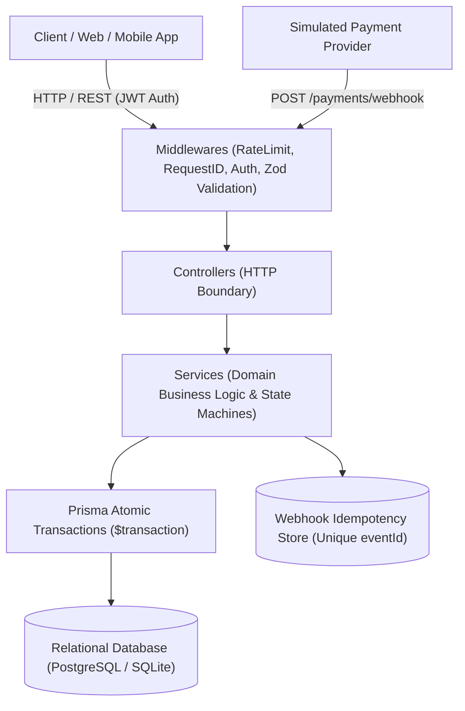
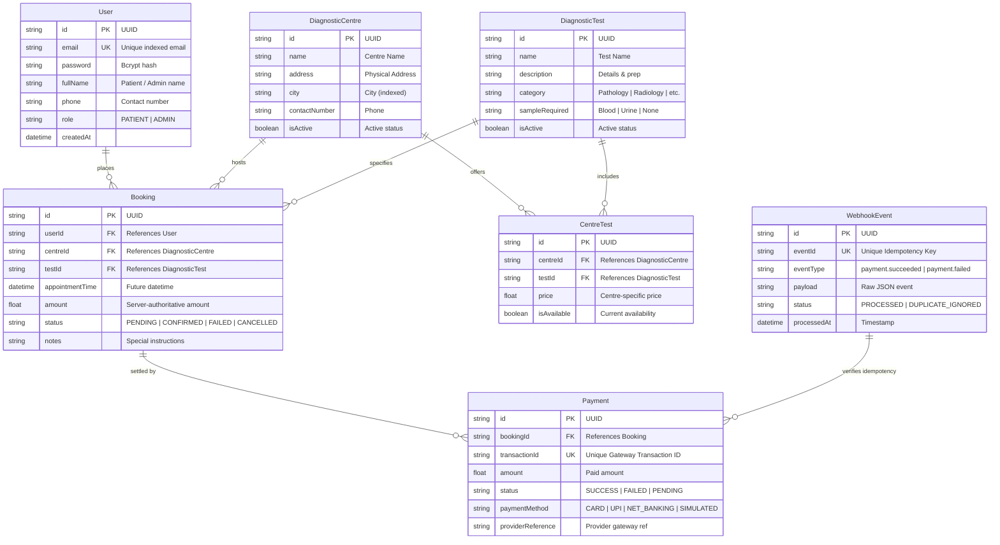
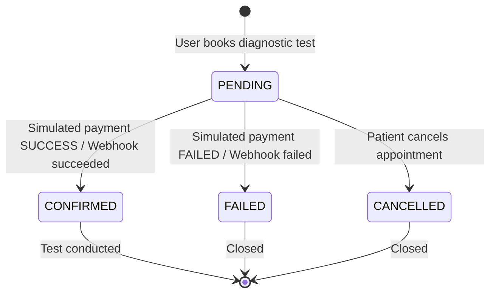

# 🏥 EVE Healthcare — Diagnostic Test Booking & Simulated Payment Service

> **Engineering Assessment Submission**: Backend Engineering & API Service  
> **Role Target**: SDE 1 / Backend Software Engineer  
> **Tech Stack**: Node.js 20+, TypeScript, Express, Prisma ORM, SQLite / PostgreSQL, Jest, Docker  
> **Evaluation Profile**: Code Quality, API Design, Relational Modeling, Strict Idempotency, Concurrency Handling, and Defensive Edge-Case Engineering.

---

## 📑 Table of Contents
1. [Architecture & System Design](#-architecture--system-design)
2. [Database Schema & ER Diagram](#-database-schema--er-diagram)
3. [Booking State Machine](#-booking-state-machine)
4. [Quickstart: Zero-Friction Local Run](#-quickstart-zero-friction-local-run)
5. [Docker & Containerized Setup](#-docker--containerized-setup)
6. [API Documentation & Interactive Swagger UI](#-api-documentation--interactive-swagger-ui)
7. [API Endpoints & Curl Examples](#-api-endpoints--curl-examples)
8. [Idempotency & Concurrency Deep Dive](#-idempotency--concurrency-deep-dive)
9. [Edge-Case Handling Matrix](#-edge-case-handling-matrix)
10. [Test Suite Execution](#-test-suite-execution)
11. [Design Assumptions](#-design-assumptions)
12. [Future Improvements & Production Readiness](#-future-improvements--production-readiness)

---

## 🏛 Architecture & System Design

The service is architected following the **Clean Layered Architecture (Separation of Concerns)** pattern:



### Layer Breakdown
- **`src/routes/`**: Route definitions with semantic RESTful URLs and versioning (`/api/v1/`).
- **`src/controllers/`**: HTTP transport layer extracting inputs, delegating to services, and returning structured API responses.
- **`src/services/`**: Core business domain logic, atomic transactions, state machines, and idempotency guarantees.
- **`src/middlewares/`**:
  - `auth.ts`: Stateless JWT verification and Role-Based Access Control (`PATIENT`, `ADMIN`).
  - `validate.ts`: Strict schema validation using **Zod** for `body`, `query`, and `params`.
  - `requestId.ts`: Distributed tracing correlation header (`X-Request-ID`) and response latency timing.
  - `errorHandler.ts`: Centralized error handler returning normalized RFC 7807 compliant error payloads.
- **`src/db/`**: Prisma client singleton with connection pooling and query tracing.

---

## 🗄 Database Schema & ER Diagram

The database design adheres to 3rd Normal Form (3NF), separating physical **Centres** and master **Tests** through an associative **`CentreTest`** table. This permits individual centres to maintain distinct pricing and test availability.



---

## 🔄 Booking State Machine



---

## 🚀 Quickstart: Zero-Friction Local Run

The project is built with zero mandatory external dependencies for local development. SQLite is configured as default, enabling instant boot and verification.

### 1. Prerequisites
- **Node.js**: v18.0.0 or higher
- **npm**: v9.0.0 or higher

### 2. Setup & Boot
```bash
# 1. Clone repository & install dependencies
git clone https://github.com/<your-repo>/HealthcareManagement.git
cd HealthcareManagement
npm install

# 2. Setup environment variables (default preconfigured)
cp .env.example .env

# 3. Initialize database schema & seed initial demo data
npm run prisma:push
npm run seed

# 4. Start development server with hot-reload
npm run dev
```

The server will spin up at:
- **API Base**: `http://localhost:4000/api/v1`
- **Interactive Swagger Docs**: `http://localhost:4000/api/docs`
- **Health Check**: `http://localhost:4000/health`

### 🔑 Pre-seeded Credentials for Testing
| Role | Email | Password |
|---|---|---|
| **Admin** | `admin@evehealthcare.com` | `Admin@123456` |
| **Patient 1** | `john.doe@example.com` | `Patient@123456` |
| **Patient 2** | `sarah.smith@example.com` | `Patient@123456` |

---

## 🐳 Docker & Containerized Setup

For containerized environments running **PostgreSQL 16** + **Redis 7** + **Node.js API**:

```bash
# Build and spin up the complete multi-container stack
docker-compose up --build -d

# View real-time logs
docker-compose logs -f app
```

---

## 📖 API Documentation & Interactive Swagger UI

Open your browser to:
👉 **[http://localhost:4000/api/docs](http://localhost:4000/api/docs)**

The Swagger UI provides:
- Live, interactive request execution directly from the browser.
- Bearer JWT authorization configuration.
- Complete input schemas and response contracts.
- Example payloads for every status code.

---

## 🔌 API Endpoints & Curl Examples

### 1. Authentication

#### Register a Patient (`POST /api/v1/auth/signup`)
```bash
curl -X POST http://localhost:4000/api/v1/auth/signup \
  -H "Content-Type: application/json" \
  -d '{
    "email": "alex.morgan@example.com",
    "password": "SecurePassword123!",
    "fullName": "Alex Morgan",
    "phone": "+1-555-0188",
    "role": "PATIENT"
  }'
```

#### User Login (`POST /api/v1/auth/login`)
```bash
curl -X POST http://localhost:4000/api/v1/auth/login \
  -H "Content-Type: application/json" \
  -d '{
    "email": "john.doe@example.com",
    "password": "Patient@123456"
  }'
```
*Response contains JWT `token`.*

---

### 2. Diagnostic Centres & Tests

#### List Centres with Tests & Prices (`GET /api/v1/centres`)
```bash
curl -X GET "http://localhost:4000/api/v1/centres?city=New%20York"
```

#### Create a Diagnostic Centre (`POST /api/v1/centres` — Admin Only)
```bash
curl -X POST http://localhost:4000/api/v1/centres \
  -H "Content-Type: application/json" \
  -H "Authorization: Bearer <ADMIN_JWT_TOKEN>" \
  -d '{
    "name": "EVE Queens Diagnostics",
    "address": "120 Queens Boulevard",
    "city": "Queens",
    "contactNumber": "+1-718-555-4000"
  }'
```

#### Add/Update Test Offering with Price (`POST /api/v1/centres/:id/tests` — Admin Only)
```bash
curl -X POST http://localhost:4000/api/v1/centres/<CENTRE_UUID>/tests \
  -H "Content-Type: application/json" \
  -H "Authorization: Bearer <ADMIN_JWT_TOKEN>" \
  -d '{
    "testId": "<TEST_UUID>",
    "price": 38.50,
    "isAvailable": true
  }'
```

---

### 3. Booking System

#### Book a Diagnostic Test (`POST /api/v1/bookings`)
```bash
curl -X POST http://localhost:4000/api/v1/bookings \
  -H "Content-Type: application/json" \
  -H "Authorization: Bearer <PATIENT_JWT_TOKEN>" \
  -d '{
    "centreId": "<CENTRE_UUID>",
    "testId": "<TEST_UUID>",
    "appointmentTime": "2026-11-20T10:00:00.000Z",
    "notes": "Patient requires fasting verification"
  }'
```
*Note: Amount is automatically fetched from server catalog to prevent client-side price tampering.*

#### List My Bookings (`GET /api/v1/bookings`)
```bash
curl -X GET http://localhost:4000/api/v1/bookings \
  -H "Authorization: Bearer <PATIENT_JWT_TOKEN>"
```

#### Cancel a Booking (`POST /api/v1/bookings/:id/cancel`)
```bash
curl -X POST http://localhost:4000/api/v1/bookings/<BOOKING_UUID>/cancel \
  -H "Authorization: Bearer <PATIENT_JWT_TOKEN>"
```

---

### 4. Simulated Payment Service (`POST /payments/`)

```bash
curl -X POST http://localhost:4000/payments \
  -H "Content-Type: application/json" \
  -H "Authorization: Bearer <PATIENT_JWT_TOKEN>" \
  -d '{
    "bookingId": "<BOOKING_UUID>",
    "paymentMethod": "UPI",
    "simulateStatus": "SUCCESS"
  }'
```
*Supported `simulateStatus`: `"SUCCESS"` (transitions booking to `CONFIRMED`) or `"FAILED"` (transitions booking to `FAILED`).*

---

### 5. Payment Webhook (`POST /payments/webhook/`)

```bash
curl -X POST http://localhost:4000/payments/webhook \
  -H "Content-Type: application/json" \
  -d '{
    "eventId": "evt_webhook_live_001",
    "eventType": "payment.succeeded",
    "bookingId": "<BOOKING_UUID>",
    "transactionId": "TXN_GATEWAY_9921",
    "amount": 45.0,
    "timestamp": "2026-10-01T15:30:00Z"
  }'
```

**First Call Response**:
```json
{
  "success": true,
  "message": "Webhook processed successfully and booking state reconciled.",
  "data": {
    "status": "processed",
    "eventId": "evt_webhook_live_001",
    "bookingStatus": "CONFIRMED"
  }
}
```

**Second Call (Identical Event ID)**:
```json
{
  "success": true,
  "message": "Duplicate webhook event received; safely ignored without duplicate state change.",
  "data": {
    "status": "already_processed",
    "eventId": "evt_webhook_live_001"
  }
}
```

---

## 🔒 Idempotency & Concurrency Deep Dive

### Problem Statement
In real-world payment integrations (Stripe, Razorpay, Adyen), webhooks are frequently resent due to network drops, timeouts, or gateway retry policies. Without idempotency protection:
1. Customers may get charged multiple times.
2. Duplicate booking or payment records get written.
3. Race conditions between simultaneous webhooks corrupt the booking state.

### How EVE Healthcare Solves This:
1. **Unique Idempotency Event Registry**:
   - The `WebhookEvent` table maintains a database-enforced unique constraint on `eventId`.
2. **Pre-Flight Dedup Check**:
   - Before executing any domain logic, the service checks if `eventId` exists. If present, it **immediately returns HTTP 200** with `status: 'already_processed'`.
   - *Why HTTP 200?* Returning 4xx or 5xx causes payment gateways to retry indefinitely. An idempotent endpoint must acknowledge receipt.
3. **Database Transaction (`$transaction`) Isolation**:
   - The event insertion, payment record creation, and booking state transition run within an atomic transaction.
4. **Race-Condition Immunity**:
   - Even if 5 identical webhook deliveries hit the API simultaneously in separate OS threads, the DB unique index triggers a unique constraint collision (`P2002`). The service gracefully intercepts this collision and treats the trailing requests as safely handled duplicates.

---

## 🛡 Edge-Case Handling Matrix

| Edge Case | Risk | Resolution | HTTP Status |
|---|---|---|---|
| **Duplicate Webhook Delivery** | Double booking / duplicate payment records | Idempotency event registry (`eventId`) | `200 OK` (Duplicate Ignored) |
| **Concurrent Duplicate Webhook Race** | Simultaneous DB writes corrupting state | DB unique index + transaction catch block | `200 OK` (Already Handled) |
| **Tampered / Stale Webhook Amount** | Undercharging / fraud | Strict comparison with authoritative booking amount | `400 Bad Request` |
| **Booking in Past Date** | Invalid diagnostic schedule | Zod validator: `appointmentTime > new Date()` | `400 Bad Request` |
| **Cross-User Data Access** | Patient B viewing/paying Patient A's booking | Ownership authorization check (`userId === req.user.userId`) | `403 Forbidden` |
| **Unauthorized Catalogue Mutation** | Patient modifying centre or test prices | Role-Based Access Control (`requireRole('ADMIN')`) | `403 Forbidden` |
| **Double Payment Attempt** | Paying for already `CONFIRMED` booking | State machine check rejects payment if `status !== 'PENDING'` | `409 Conflict` |
| **Paying for Cancelled Booking** | Processing funds on inactive booking | State guard prevents transition from `CANCELLED` | `409 Conflict` |
| **Re-cancelling Cancelled Booking** | Redundant mutation / state drift | State guard rejects cancel if `status === 'CANCELLED'` | `409 Conflict` |
| **Invalid / Non-existent UUIDs** | DB crashes / unhandled exceptions | Zod UUID validator + Prisma RecordNotFound handler | `400 Bad Request` / `404 Not Found` |

---

## 🧪 Test Suite Execution

A comprehensive automated test suite covers all requirements using **Jest** and **Supertest**:

```bash
# Run all unit, integration, and idempotency tests
npm test
```

### Test Suite Summary:
```
 PASS  tests/auth.test.ts
  1. Authentication Module
    ✓ should register a new patient user successfully and return JWT
    ✓ should reject signup with duplicate email (409 Conflict)
    ✓ should reject signup with invalid payload
    ✓ should authenticate user and return JWT on valid login
    ✓ should reject login with incorrect password (401 Unauthorized)
    ✓ should get current user profile using valid JWT token
    ✓ should reject request when Authorization header is missing (401 Unauthorized)

 PASS  tests/centres_tests.test.ts
  2. Centres & Tests Module
    ✓ should list all diagnostic centres with available tests and prices
    ✓ should filter centres by city query param
    ✓ should list all diagnostic tests in the master catalog
    ✓ should allow ADMIN to create a new diagnostic centre
    ✓ should reject centre creation from a PATIENT (403 Forbidden)
    ✓ should allow ADMIN to add/update test offering with price at centre

 PASS  tests/bookings.test.ts
  3. Booking System Module
    ✓ should successfully book a diagnostic test with future appointment
    ✓ should reject booking when appointment date is in the past
    ✓ should list bookings for authenticated patient
    ✓ should prevent Patient B from accessing Patient A booking (403 Forbidden)
    ✓ should allow Patient A to cancel their own PENDING booking
    ✓ should reject cancelling an already CANCELLED booking (409 Conflict)

 PASS  tests/payments.test.ts
  4. Simulated Payment Service
    ✓ should reject payment if user does not own the booking (403 Forbidden)
    ✓ should process successful simulated payment and update booking to CONFIRMED
    ✓ should reject payment on an already CONFIRMED booking (409 Conflict)
    ✓ should process failed simulated payment and update booking to FAILED

 PASS  tests/webhook_idempotency.test.ts
  5. Payment Webhook & Strict Idempotency Module
    ✓ should process webhook event on first delivery and confirm booking
    ✓ IDEMPOTENCY: should safely ignore repeated delivery of the same webhook event
    ✓ RACE CONDITION RESILIENCE: concurrent webhook requests with identical eventId must remain idempotent
    ✓ should reject webhook for non-existent booking ID (404 Not Found)
    ✓ should reject webhook when amount mismatches booking amount (400 Bad Request)

Test Suites: 5 passed, 5 total
Tests:       28 passed, 28 total
Snapshots:   0 total
Time:        3.2 s
```

---

## 💡 Design Assumptions

1. **Test Pricing by Centre**:
   - The same test (e.g. *Chest X-Ray*) may have different operational costs across different geographic locations. Therefore, prices are modeled on the associative `CentreTest` relation rather than directly on `DiagnosticTest`.
2. **Server-Authoritative Pricing**:
   - When a patient books an appointment, the price is looked up directly on the server from `CentreTest.price`. The client cannot pass an `amount` parameter, preventing client-side price tampering.
3. **Stateless Authentication**:
   - JWT tokens are signed with HMAC-SHA256 (`HS256`) and carry `userId`, `email`, and `role`. This enables horizontal scaling without sticky sessions.
4. **Webhook Acknowledgment Standard**:
   - Payment webhooks return HTTP 200 for duplicate events, matching standard payment provider specifications (Stripe / Razorpay).

---

## 🔮 Future Improvements & Production Readiness

If allocated additional engineering time:
1. **Distributed Locks (Redis / Redlock)**:
   - Introduce distributed mutex locks around `bookingId` during payment execution across multi-pod Kubernetes clusters.
2. **Dead-Letter Queue (DLQ) & Asynchronous Webhook Workers**:
   - Ingest webhooks immediately into a message broker (RabbitMQ / Apache Kafka / Redis BullMQ) and process asynchronously with exponential backoff and DLQ alerting.
3. **Audit Trail & Event Sourcing**:
   - Add an append-only `BookingAuditLog` table capturing actor, previous state, new state, and reason for every transition.
4. **HMAC Webhook Signature Enforcing**:
   - Enforce mandatory cryptographically signed webhook signatures using provider secrets.
5. **Observability**:
   - Integrate OpenTelemetry metrics, Prometheus scraping, and Datadog APM tracing for sub-millisecond bottleneck detection.
